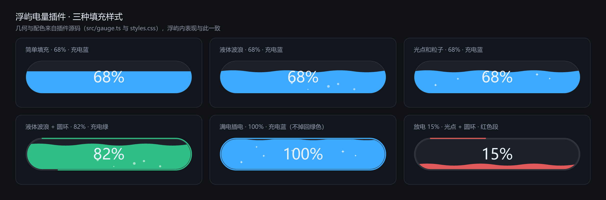

# 电量 · Battery

浮屿（Fuyu）插件。在岛上显示电池电量与充电状态：展开页的胶囊像进度条一样从左往右填满，挂件位保留原来的水位样式（由下往上涨），支持光点粒子动画。



## 功能

- **三种填充样式**：简单填充、液体波浪、光点和粒子
- **胶囊填充**：展开页液面从左往右推进，挂件位由下往上涨；插着电源时用设定颜色（满电也是该颜色），纯电池时按电量变绿 / 黄 / 红
- **外圈描边**：沿胶囊边缘加一圈同色描边，勾出液体轮廓
- **收起条**：图标 + 迷你进度条 + 百分比
- **页面**：大号胶囊、状态、预计充满 / 剩余可用、充电功率、电池名称
- **提醒**：电量跌到阈值提醒一次，充满提醒拔电，都在岛上弹出，阈值与开关可配
- **临时浮窗**：接入 / 拔掉电源、跌到低电量、充满时，在岛下方弹一个玻璃胶囊，停留 1.5 秒后淡出

## 数据来源

宿主（Node 侧）常驻一个 `assets/battery.ps1` 子进程，两种请求：

- `PING` 每 30 秒一次，走 WMI 读完整数据（电量、功率、剩余时间），单次约 26 毫秒
- `POLL` 每 800 毫秒一次，只读 kernel32 的电源状态，单次约 0.04 毫秒

分开的原因：`Win32_Battery` 走 WMI，插拔电源后要一两秒才更新，而任务栏电源图标用的内核接口是毫秒级。拔插电由 `POLL` 捕捉，插上或拔掉后 800 毫秒内颜色与状态就会变；容量、功率这些慢变量仍由 `PING` 负责。

`POLL` 只更新「是否接电源」，电量百分比与充电状态都以 `PING` 的完整读为准——内核与 WMI 偶尔差一个百分点，两路混用会让数字来回跳；内核的「充电中」标志位也不是每台机器都置位（这台 HB5489P9EGW 充电时就是 0）。

主读数来自 `Win32_Battery`：

| 字段 | 含义 |
|---|---|
| `EstimatedChargeRemaining` | 电量百分比 |
| `BatteryStatus` | 1 放电，2 接电源，3 已充满，6–9 充电中 |
| `TimeToFullCharge` | 充满还需分钟数（充电时，驱动常为空） |
| `EstimatedRunTime` | 剩余可用分钟数（放电时，未知时是 `71582788` 这类哨兵值，已丢弃） |

功率与更可靠的充满估算来自 `root\wmi` 的 `BatteryStatus` / `BatteryFullChargedCapacity`：

| 字段 | 含义 |
|---|---|
| `ChargeRate` / `DischargeRate` | 充放电功率（毫瓦），页面除以 1000 显示为瓦 |
| `RemainingCapacity` | 当前容量（毫瓦时） |
| `FullChargedCapacity` | 满电容量，用来算“还剩多少才充满”，缓存 10 分钟 |

驱动不填这些字段时页面显示 `—`，不会编一个假数字。读不到电池时保留上次读数并标记状态，不会把数字归零。

## 状态怎么判

先定「接没接电」，再定「有没有在充」，顺序不能反：插电瞬间 WMI 还在说「在用电池」，如果先判充电再纠正接电，就会得出「接了电 + 没充电 -> 显示使用中」。

- **接电**：内核 `ACLineStatus`（毫秒级）优先，其次 `root\wmi PowerOnline`，最后 `BatteryStatus != 1`
- **充电**：`root\wmi Charging`，或 `ChargeRate > 0` 且 `DischargeRate = 0`
- **满电**：`BatteryStatus = 3`，或接电且电量 100%
- **没进电**：要连续 3 次完整读（约 1–1.5 分钟）都读不到电流才算数。这台机器的充电电流是脉冲式的，插着电也会出现十几秒 `Charging=False`，单次判定会让页面来回翻；中途任何一次读到电流就清零。

于是页面只有三种接电态：`充电中` / `已接电源`（接电但没进电，多半是电池保护阈值或满电停充）/ `已充满`，`使用中` 只留给拔掉电源之后。

## 时间估算

充电电流是脉冲式的（这台机器在 1–17 W 之间跳），单点采样算出来的「预计充满」会在三小时和八小时之间来回摆，所以：

- 取最近 9 次完整读的**中位数**，再叠一层慢滤（0.65 旧 + 0.35 新）
- 显示值取整到 5 分钟，且变化不到 **12% 或 8 分钟就不动**，避免每半分钟跳一次
- 插拔瞬间清空采样，不拿上一个电源状态的电流算这一个

「剩余可用」用两路交叉校验：系统给的 `EstimatedRunTime` 和自己的「剩余容量 ÷ 放电中位数」差三倍以上，就判定系统值无效。接电但没在充电时不给剩余时间——那时的放电功率是供电仲裁的噪声，算出来是假的。

## 临时浮窗

浮窗用浮屿的 `island.overlay/v1` 插槽，落在岛下方，不另开窗口、不需要实验接口。宿主只发一条 `battery.hud` 数据并管时序：弹出 0.34 秒 → 停留 1.5 秒 → 淡出 0.45 秒；浮层播完回报宿主撤掉，回报丢了宿主也有 3.5 秒兜底。同类事件 1 分钟内只弹一次。

低电量和充满原本的系统通知在浮窗开启时不再重复发；关掉「临时浮窗」开关则退回原来的通知。想不插拔也看效果，命令面板执行「测试电量浮窗」，依次切四种状态。视觉原型在 `build/hud-preview.html`，和插件用的是同一套配色与时序常量。

## 配置

| 项 | 说明 |
|---|---|
| 填充动画 | `simple` / `wave` / `sparkle` |
| 充电时的颜色 | `green` / `blue` / `accent` / `custom` |
| 自定义颜色 | `#rrggbb`，仅 `custom` 时生效 |
| 显示外圈描边 | 沿胶囊边缘加一圈同色描边，电量由液面长度表达 |
| 开启动画 | 关闭后波浪与粒子静止，适合常驻省电 |
| 低电量提醒 | 跌破阈值时在岛上提醒一次，插电或回血 5 个百分点后重置 |
| 低电量阈值 | `10` / `15` / `20` / `30`，默认 20 |
| 充满提醒 | 充到 100% 提醒拔电，减少长期满电搁置 |
| 临时浮窗 | 插拔 / 低电量 / 充满时弹 1.5 秒的岛下浮窗，默认开 |

放电阈值固定为：高于 40% 绿色，21–40% 黄色，20% 及以下红色。

配置变更走宿主侧的 `ctx.config.onChange`，保存后立刻推给岛上；另有 10 秒一次的文件轮询兜底（读 `plugins-v3/data/@wai023/battery/config.json`），旧版浮屿没有 `onChange` 时也不会失联。

## 安装

到 [Releases](https://github.com/wai023/battery/releases) 下载最新的 `wai023-battery-*.fuyu`，双击安装。浮屿若拦第三方插件，先在设置里打开「允许运行第三方插件」。

自己构建：`npm i && npm run package`，产物落在 `build/` 下。

## 已知限制

- 多电池设备只取第一块。
- 充放电功率来自 `root\wmi`，部分驱动不上报，此时页面不显示功率一列。
- 台式机无电池时显示「未检测到电池」。
- `island.widget/v1` 尚未进入市场检查器的白名单，因此暂未上架，只能本地分发。
- 临时浮窗是岛下浮层，不是独立窗口；岛展开瞬间的位置变化归宿主，浮层不跟着做共享元素动画。

## 开发

```bash
npm run typecheck
npm run lint
npm test
npm run package
```

`docs/preview.png` 与 `build/preview.html` 用同一套几何（`src/gauge.ts`）生成，改了配色或形状记得一起更新：

```bash
npm i -D @resvg/resvg-js
node --experimental-strip-types tools/preview-image.mjs
```
